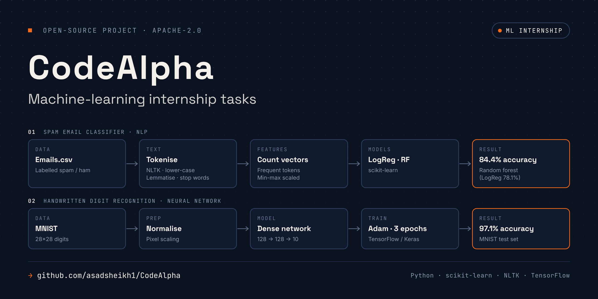

<p align="center">
  
</p>

# CodeAlpha — Machine-learning internship tasks

Two beginner-level tasks completed during the CodeAlpha machine-learning internship.

| Notebook | Task | Approach | Result (test set, from the notebook) |
|---|---|---|---|
| [Spam Email Classifier - NLP](Spam%20Email%20Classifier%20-%20NLP.ipynb) | Classify emails as spam or ham | NLTK tokenisation, lower-casing, WordNet lemmatisation and stop-word removal → token count vectors (frequent tokens) → min-max scaling → logistic regression and random forest (scikit-learn), 80/20 split | Random forest **84.4%** accuracy · logistic regression 78.1% |
| [Handwritten Character Recognition - Neural Network](Handwritten%20Character%20Recognition%20-%20Neural%20Network.ipynb) | Recognise handwritten digits | MNIST → normalisation → dense network (128 → 128 → 10, ReLU / softmax), Adam, 3 epochs (TensorFlow / Keras); then tested on the hand-drawn digits in [`digits/`](digits) | **97.1%** accuracy on the MNIST test set |

## Run it

```bash
pip install numpy pandas seaborn matplotlib nltk scikit-learn tensorflow opencv-python requests
jupyter notebook
```

The spam notebook reads [`Emails.csv`](Emails.csv); the digit notebook downloads MNIST through Keras.

## Licence

[Apache-2.0](LICENSE) · [Asad Sheikh](https://github.com/asadsheikh1)
